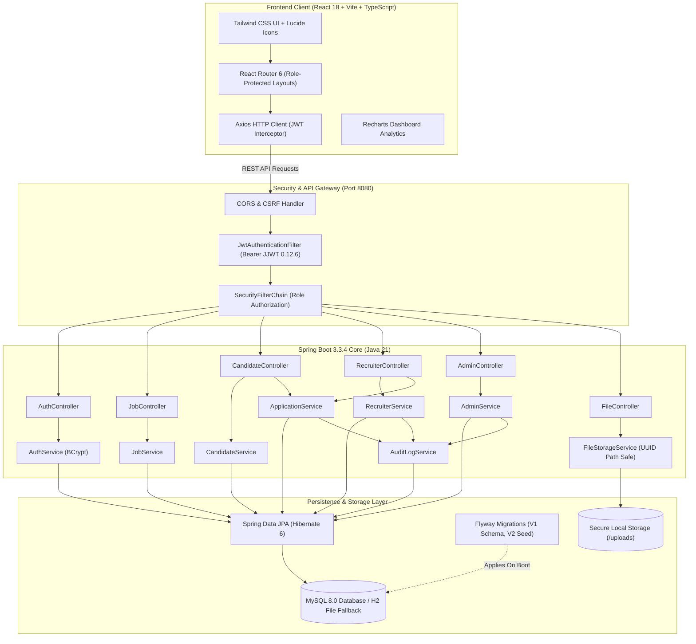
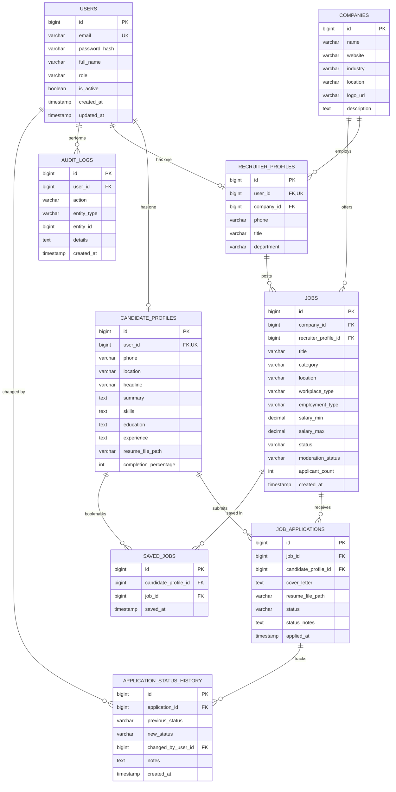

# CareerConnect — Modern Full-Stack Recruitment Platform

[](https://www.oracle.com/java/)
[](https://spring.io/projects/spring-boot)
[](https://react.dev/)
[](https://www.typescriptlang.org/)
[](https://tailwindcss.com/)
[](https://www.mysql.com/)
[](https://flywaydb.org/)
[](https://vitejs.dev/)

**CareerConnect** is a commercial-grade, full-stack recruitment SaaS platform built for a **Java Full Stack Development Technical Training Presentation**. The application connects job seekers with recruiters and platform administrators, featuring secure role-based access control, rich faceted search, candidate application workflows with immutable audit history, recruiter pipeline management, and real-time administrative governance.

---

## 🏛️ System Architecture



---

## 🗄️ Database Entity-Relationship Diagram



---

## 🚀 Key Features by User Role

### 🌐 Public Visitors
- **Dynamic Landing Page**: Hero search, trusted company badges, featured jobs, category grid, and workflow guide.
- **Faceted Job Search**: Filter by keyword, workplace type (*Remote*, *Hybrid*, *On-site*), employment type (*Full-time*, *Contract*, *Internship*), and industry. Synchronized with browser URL parameters for instant sharing.
- **Company Directory**: View employer profiles, websites, locations, and active job openings.
- **Authentication**: JWT login and registration with BCrypt hashing and client validation.

### 👨‍💼 Job Seekers (Candidates)
- **Candidate Dashboard**: Profile completion meter, application status counts, and personalized recommendations.
- **Application Workflow**: Apply with stored profile resume or upload a targeted CV with a cover letter.
- **Status Audit Trail**: Real-time modal displaying every status transition, reviewer timestamp, and interview notes.
- **Saved Jobs**: One-click bookmarking of target job openings.
- **Resume Management**: Secure PDF/DOCX file upload with validation and download capabilities.

### 👔 Recruiters & Employers
- **Recruiter Dashboard**: Recharts visual analytics showing monthly application trends and hiring pipeline distribution.
- **Job Posting Management**: Create, edit, and close job postings with detailed requirements, salary bands, and tags.
- **Applicant Management**: Filter candidates by job listing, inspect resumes, and advance candidates through the pipeline (`APPLIED` → `UNDER_REVIEW` → `SHORTLISTED` → `SELECTED` / `REJECTED`).
- **Data Isolation**: Strict cross-recruiter isolation enforced in Spring Data JPA queries.

### 🛡️ System Administrators
- **Platform Analytics**: Database metrics across candidates, recruiters, jobs, and applications.
- **User Governance**: Search users, filter by role, and activate/suspend accounts with audit reasons. Suspended accounts are immediately locked out by Spring Security.
- **Content Moderation**: Review recruiter job postings with approve/reject workflow.
- **Enterprise Audit Logs**: Immutable log feed tracking user logins, job creations, applications, and status updates.

---

## 🔑 Pre-Configured Demo Accounts

For demonstration convenience, the login page (`/login`) includes **1-Click Quick Demo Login buttons**:

| Role | Email | Password | Access Highlights |
|---|---|---|---|
| **System Admin** | `admin@careerconnect.com` | `Admin@123` | Platform analytics, user governance, moderation, audit logs |
| **Recruiter** | `recruiter.sarah@techcorp.com` | `Recruiter@123` | Job creation, applicant reviews, pipeline status transitions |
| **Candidate** | `candidate.alex@example.com` | `Candidate@123` | Job browsing, 1-click apply, resume management, status tracking |

---

## 🛠️ Technology Stack Summary

| Layer | Technologies Used |
|---|---|
| **Backend** | Java 21, Spring Boot 3.3.4, Spring Web, Spring Data JPA, Spring Security, Spring Validation, Spring Boot Actuator, JJWT 0.12.6, Lombok, Flyway |
| **Frontend** | React 18, Vite 5.4, TypeScript 5.5, Tailwind CSS 3.4, React Router 6, Lucide React, Axios, React Hook Form, Zod, Recharts, React Hot Toast |
| **Database** | MySQL 8.0 (Production / Docker) / Persistent H2 in MySQL Compatibility Mode (Zero-Dependency Dev) |
| **DevOps & Tools** | Docker Compose, Maven, Git, Postman Collection, Multi-stage Dockerfiles |

---

## 🏃 Getting Started & Execution

### Prerequisites
- **Java 21 JDK** installed and available in `PATH`.
- **Node.js 18+** & npm.
- **Docker Desktop** (Optional, for running MySQL container).

---

### Option A: Quick Zero-Dependency Run (Instant Demo)
CareerConnect is configured by default with a persistent, file-based MySQL compatibility profile using Flyway. This allows you to boot the full application immediately without installing or configuring a MySQL server.

#### 1. Start the Java Backend
```powershell
cd c:\projecttt\backend
mvn spring-boot:run
```
*The backend boots on `http://localhost:8080`. Flyway automatically executes `V1__init_schema.sql` and `V2__seed_demo_data.sql`.*

#### 2. Start the React Frontend
```powershell
cd c:\projecttt\frontend
npm.cmd run dev
```
*The frontend boots on `http://localhost:5173`. Open your browser to explore the platform.*

---

### Option B: Run with MySQL 8 via Docker Compose

#### 1. Launch MySQL 8 Container
```powershell
cd c:\projecttt
docker compose up -d mysql
```

#### 2. Start Backend with MySQL Profile
```powershell
cd c:\projecttt\backend
mvn spring-boot:run -Dspring-boot.run.profiles=mysql
```

#### 3. Start Frontend
```powershell
cd c:\projecttt\frontend
npm.cmd run dev
```

---

## 🧪 Automated Testing

### Backend Unit & Integration Tests (JUnit 5 & Mockito)
Run the 13 automated test suites covering authentication, job queries, applicant workflows, and security controllers:
```powershell
cd c:\projecttt\backend
mvn test
```
*Expected result: `Tests run: 13, Failures: 0, Errors: 0, Skipped: 0 — BUILD SUCCESS`*

### Frontend Production Build & TypeScript Verification
Verify TypeScript type-safety and bundle production assets:
```powershell
cd c:\projecttt\frontend
npm.cmd run build
```
*Expected result: `✓ built in ~5s with 0 errors`*

---

## 📚 REST API Reference Summary

| Method | Endpoint | Description | Role Required |
|---|---|---|---|
| `POST` | `/api/auth/register` | Register new user account | Public |
| `POST` | `/api/auth/login` | Authenticate & return JWT token | Public |
| `GET` | `/api/auth/me` | Fetch currently logged in user | Authenticated |
| `GET` | `/api/jobs` | Faceted search published jobs (paginated) | Public |
| `GET` | `/api/jobs/{id}` | Get job details and company info | Public |
| `GET` | `/api/companies` | List registered partner companies | Public |
| `GET` | `/api/candidate/dashboard` | Candidate stats, applications, recommendations | `CANDIDATE` |
| `GET` / `PUT` | `/api/candidate/profile` | View or update candidate resume profile | `CANDIDATE` |
| `POST` | `/api/candidate/applications/apply` | Apply for an open position | `CANDIDATE` |
| `POST` | `/api/candidate/applications/{id}/withdraw` | Withdraw active application | `CANDIDATE` |
| `POST` / `DELETE` | `/api/candidate/saved-jobs/{jobId}` | Bookmark or unbookmark job | `CANDIDATE` |
| `POST` | `/api/candidate/resume/upload` | Upload PDF/DOCX resume file | `CANDIDATE` |
| `GET` | `/api/recruiter/dashboard` | Metrics & monthly application trends | `RECRUITER` |
| `POST` | `/api/recruiter/jobs` | Post new vacancy | `RECRUITER` |
| `GET` | `/api/recruiter/applicants` | View applications for recruiter's jobs | `RECRUITER` |
| `PATCH` | `/api/recruiter/applicants/{id}/status` | Advance candidate pipeline status & log audit | `RECRUITER` |
| `GET` | `/api/admin/dashboard` | Platform metrics & audit stream | `ADMIN` |
| `GET` | `/api/admin/users` | User list with role filters & search | `ADMIN` |
| `PATCH` | `/api/admin/users/{id}/status` | Activate or suspend user account | `ADMIN` |
| `PATCH` | `/api/admin/jobs/{id}/moderation` | Approve or reject job posting | `ADMIN` |
| `GET` | `/api/admin/audit-logs` | Query platform audit trail | `ADMIN` |
| `GET` | `/api/files/download/{fileName}` | Securely download uploaded resume | Authenticated |

---

## 📁 Repository Structure

```
c:\projecttt/
├── backend/
│   ├── src/main/java/com/careerconnect/
│   │   ├── config/             # Web, Security, Swagger & DataInitializer
│   │   ├── controller/         # REST Controllers (Auth, Jobs, Candidate, Recruiter, Admin)
│   │   ├── dto/                # Request & Response Data Transfer Objects
│   │   ├── entity/             # JPA Entities (User, Job, Application, Company, AuditLog)
│   │   ├── exception/          # GlobalExceptionHandler & Error Responses
│   │   ├── repository/         # Spring Data JPA Repositories
│   │   ├── security/           # JWT Provider, Auth Filter & UserDetails
│   │   └── service/            # Business Logic & Service Interfaces
│   ├── src/main/resources/
│   │   ├── db/migration/       # Flyway V1 (Schema) and V2 (Seed Data)
│   │   ├── application.yml     # Master configuration
│   │   ├── application-dev.yml # Zero-dependency development profile
│   │   └── application-mysql.yml # Production MySQL profile
│   ├── src/test/java/          # JUnit 5 & Mockito test suites
│   ├── pom.xml                 # Maven Project Object Model
│   └── Dockerfile              # Multi-stage Java 21 container build
├── frontend/
│   ├── src/
│   │   ├── components/         # Common UI, Jobs, Layout components
│   │   ├── context/            # AuthContext (JWT session management)
│   │   ├── layouts/            # Public, Candidate, Recruiter, Admin layouts
│   │   ├── pages/
│   │   │   ├── auth/           # Login, Register, Forgot Password
│   │   │   ├── candidate/      # Dashboard, Profile, Applications, Saved, Resume
│   │   │   ├── recruiter/      # Dashboard, Jobs, Post Job, Applicants, Detail
│   │   │   ├── admin/          # Dashboard, Users, Jobs Moderation, Companies, Applications
│   │   │   └── public/         # Home, Job Listings, Job Detail, Companies, About, Contact
│   │   ├── services/           # Axios REST API client modules
│   │   ├── types/              # TypeScript interfaces and domain types
│   │   ├── App.tsx             # Route declarations & role boundaries
│   │   ├── main.tsx            # Application entrypoint
│   │   └── index.css           # Tailwind CSS directives
│   ├── package.json            # Node dependencies
│   ├── tailwind.config.js      # Tailwind configuration & theme tokens
│   ├── vite.config.ts          # Vite build & API proxy setup
│   └── Dockerfile              # Frontend production Nginx build
├── database/
│   ├── schema.sql              # Standalone MySQL 8 schema script
│   └── seed.sql                # Standalone demonstration seed data
├── docker-compose.yml          # Container configuration for MySQL 8, Backend, Frontend
├── CareerConnect-API.postman_collection.json # Exported REST API collection
├── PRESENTATION_GUIDE.md       # Presenter script & live demonstration guide
└── README.md                   # Project documentation
```

---

## 👥 Authors & Technical Training Credits

Developed as a showcase enterprise application for the **Java Full Stack Development Technical Training Presentation**. Built with clean architecture, enterprise security patterns, and responsive UI principles.
